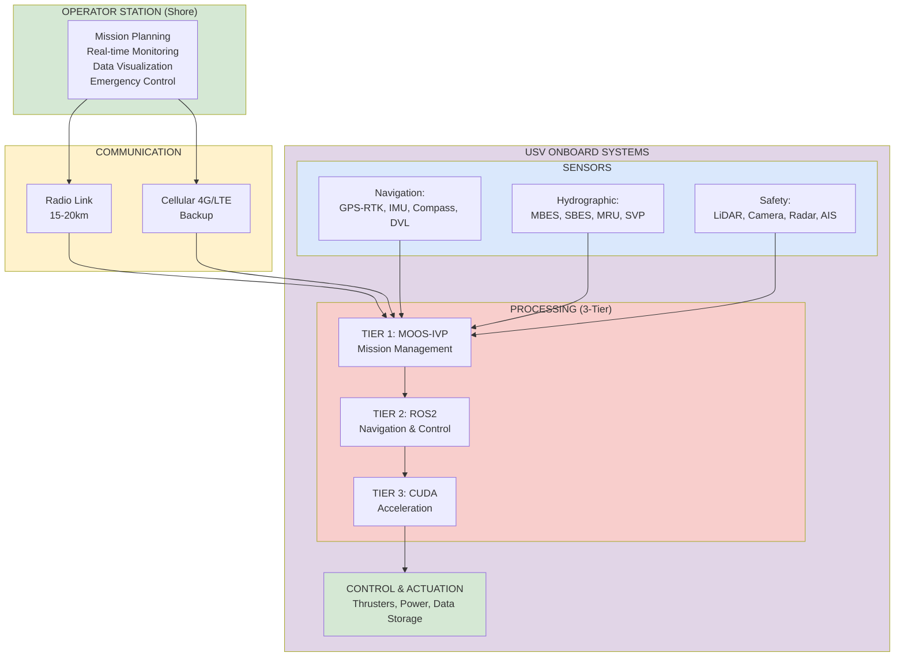
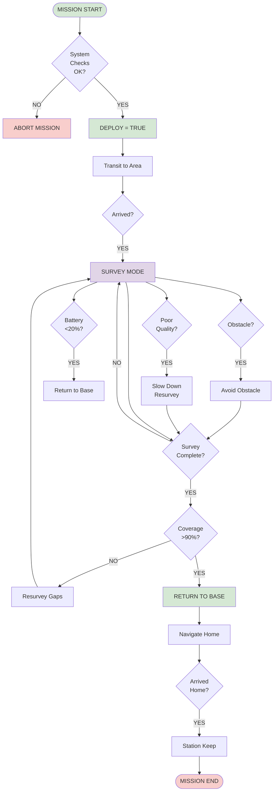
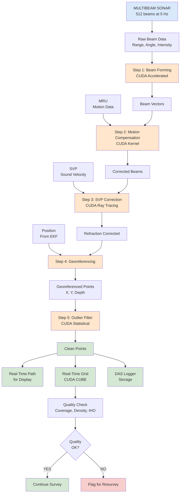
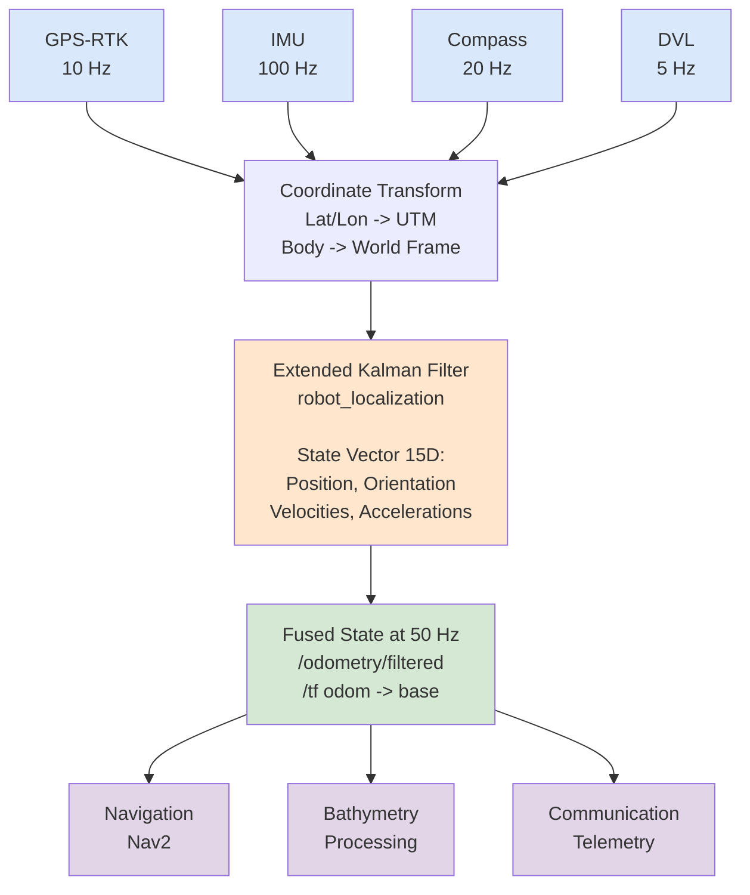
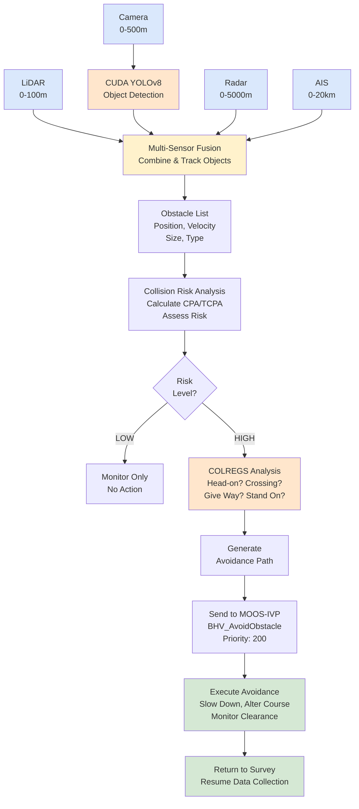
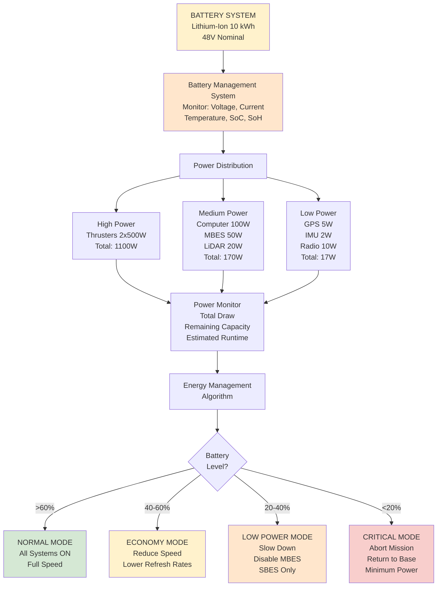
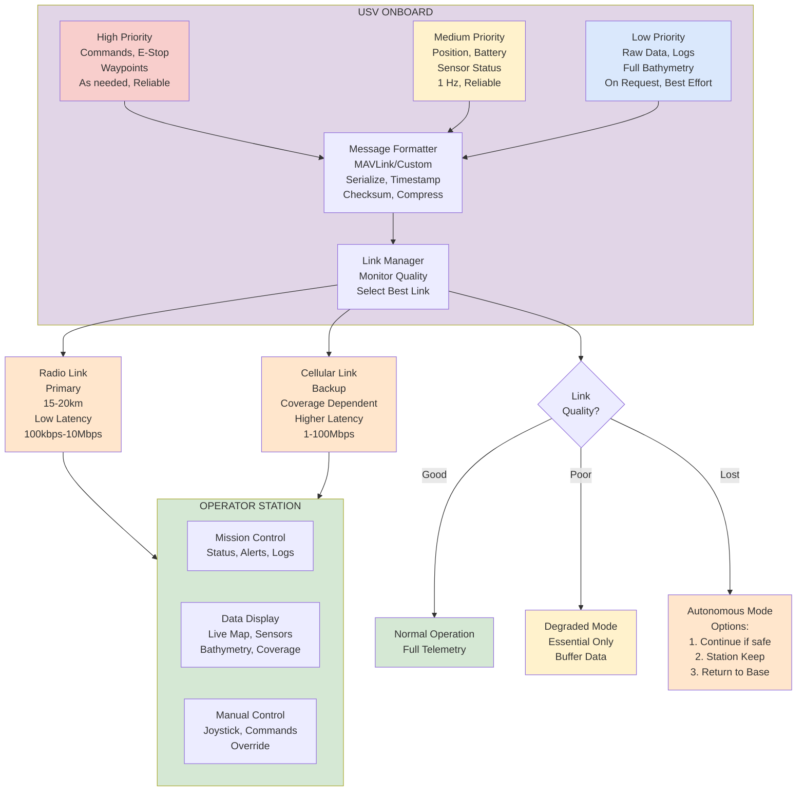
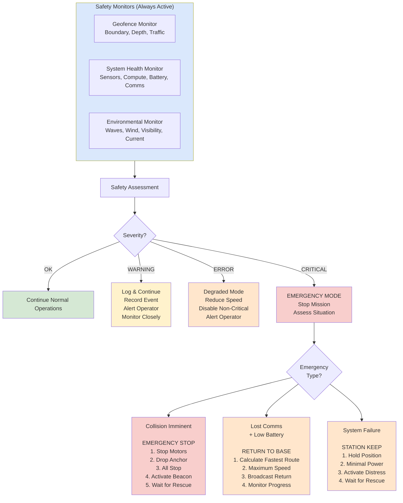

# Autonomous Hydrographic Survey USV — Architecture & Flow Diagrams

> Companion system architecture, mission state-machine, CUDA multibeam bathymetry, and COLREGs safety diagrams for **[hydro-usv-ros2](https://github.com/indian-aman/hydro-usv-ros2)**.

---

## 1. High-Level System Architecture

---

## 2. Mission Execution Flow

---

## 3. Bathymetric Processing Pipeline

---

## 4. Sensor Fusion & Localization

---

## 5. Obstacle Detection & Avoidance

---

## 6. Power Management

---

## 7. Communication & Telemetry

---

## 8. Safety & Emergency Procedures

